# Workshop 4 : Tests de Sécurité Dynamiques (DAST) et Pentest Automatisé

## Objectif
Découvrir et utiliser **OWASP ZAP** pour identifier les failles de sécurité d'une application web en cours d'exécution. Ce workshop complète les analyses statiques (SAST) vues dans les workshops précédents en testant l'application d'un point de vue extérieur.

## 1. Pré-requis
- **Docker** installé et fonctionnel.
- Application de test vulnérable (fournie dans ce dossier).

## 2. Préparation de l'application cible
Pour ce workshop, nous utilisons une application Flask délibérément vulnérable (basée sur le Workshop 2).

### Étapes pour lancer l'application :
1. Construire l'image Docker de l'application :
   ```bash
   docker build -t vulnerable-app .
   ```
2. Lancer le conteneur :
   ```bash
   docker run -d -p 5000:5000 --name my-vulnerable-app vulnerable-app
   ```
   L'application est maintenant accessible sur `http://localhost:5000`.

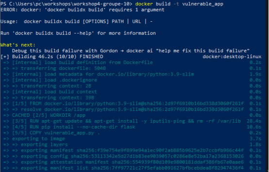
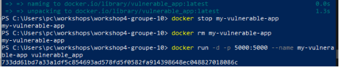
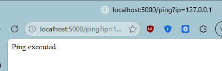

## 3. Scan Baseline (Passif)
Le scan baseline effectue une exploration passive de l'application pour détecter des problèmes de configuration, des headers manquants ou des cookies non sécurisés.

### Commande Docker pour ZAP Baseline :
**Sur Linux/macOS (Bash) :**
```bash
docker run --rm -v $(pwd):/zap/wrk/:rw -t ghcr.io/zaproxy/zaproxy:stable zap-baseline.py \
    -t http://host.docker.internal:5000 \
    -r zap_report.html
```

**Sur Windows (PowerShell) :**
```powershell
docker run --rm -v ${PWD}:/zap/wrk/:rw -t ghcr.io/zaproxy/zaproxy:stable zap-baseline.py `
    -t http://host.docker.internal:5000 `
    -r zap_report.html
```
*Note : Sur Windows/Mac, utilisez `host.docker.internal` pour pointer vers votre machine hôte depuis le conteneur Docker.*

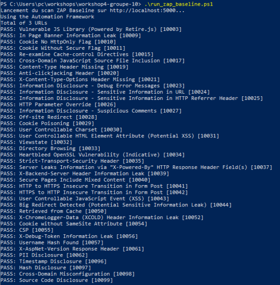
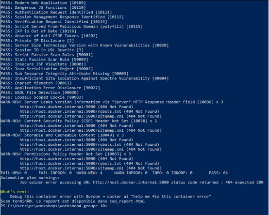
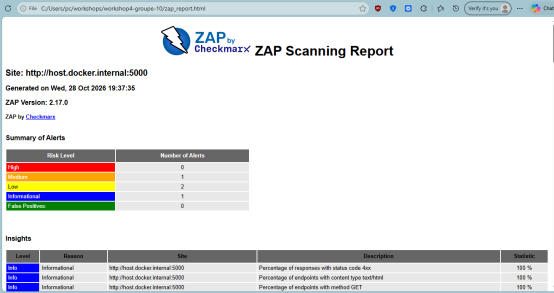

### Observations attendues :
- Analyse du rapport `zap_report.html`.
- Identification des cookies sans attribut `HttpOnly` ou `Secure`.
- Identification des headers de sécurité manquants (ex: `X-Frame-Options`, `Content-Security-Policy`).

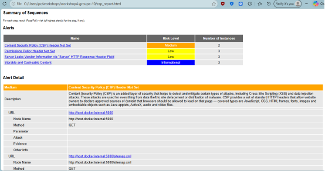
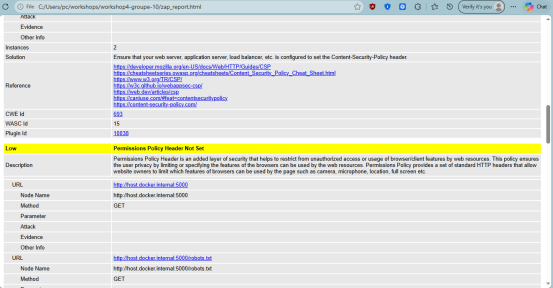

## 4. Scan Actif (Pentest Automatisé)
Le scan actif tente d'attaquer l'application en envoyant des payloads pour détecter des failles réelles comme l'Injection SQL ou le XSS. **À ne faire que sur des environnements de test.**

### Commande pour le Scan Full (Actif) :
**Sur Linux/macOS (Bash) :**
```bash
docker run --rm -v $(pwd):/zap/wrk/:rw -t ghcr.io/zaproxy/zaproxy:stable zap-full-scan.py \
    -t http://host.docker.internal:5000 \
    -r zap_full_report.html
```

**Sur Windows (PowerShell) :**
```powershell
docker run --rm -v ${PWD}:/zap/wrk/:rw -t ghcr.io/zaproxy/zaproxy:stable zap-full-scan.py `
    -t http://host.docker.internal:5000 `
    -r zap_full_report.html
```

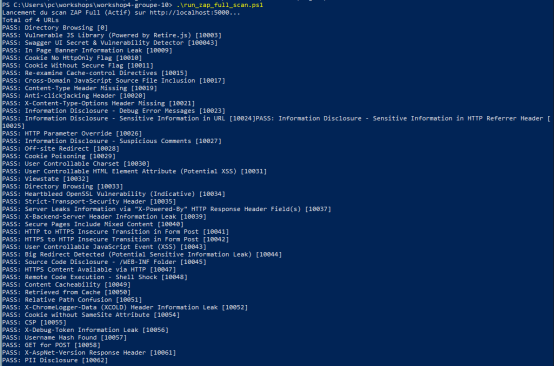
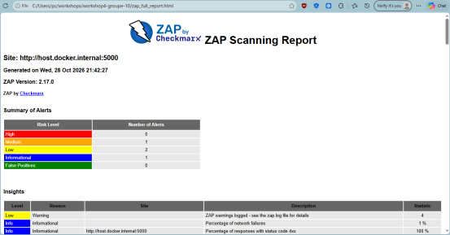

### Résultats détectés sur `vulnerable_app.py` :
ZAP devrait détecter automatiquement :
- **Cross-Site Scripting (XSS)** sur la route `/hello?name=...`.
- **SQL Injection** sur la route `/user?username=...`.
- **Command Injection** possible sur `/ping?ip=...`.

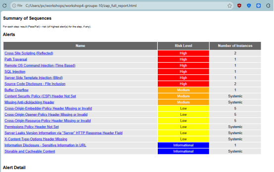

## 5. Intégration dans un pipeline CI/CD
Pour automatiser le DAST, ZAP peut être intégré dans GitHub Actions ou GitLab CI :

```yaml
# Exemple simplifié pour GitHub Actions
zap_scan:
  runs-on: ubuntu-latest
  name: Scan the web application
  steps:
    - name: Checkout
      uses: actions/checkout@v2
    - name: ZAP Baseline Scan
      uses: zaproxy/action-baseline@v0.6.0
      with:
        target: 'https://votre-site-de-test.com'
```

## 6. Discussion des risques et bonnes pratiques
- **Risques** : Le scan actif peut corrompre les données ou faire tomber le service (DoS). Toujours scanner une instance de pré-prod isolée.
- **DAST vs SAST** : Le SAST trouve les erreurs dans le code source (Workshop 2/3), le DAST trouve les failles exploitables en production (Workshop 4).
- **Remédiation** : Les résultats de ZAP doivent être priorisés et corrigés (ex: utiliser des requêtes préparées pour le SQL, échapper les sorties pour le XSS).
# workshop4-groupe-10
